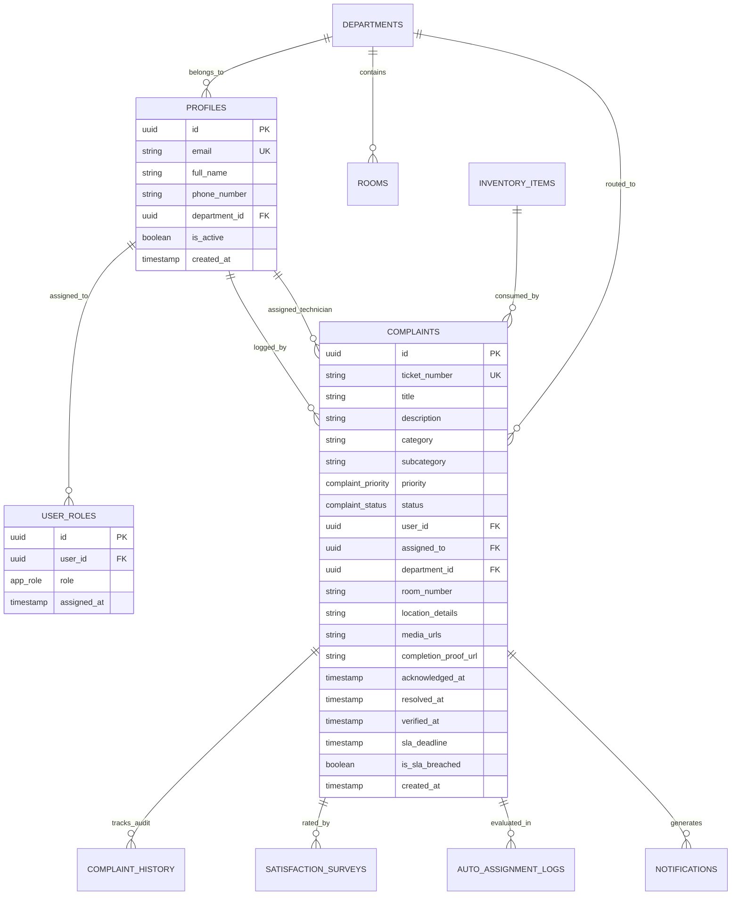

# 🛠️ PU UNICARE — Comprehensive Technical Architecture & Engineering Manual

> **System Name:** Parul University Centralized Infrastructure & Maintenance Platform (PU UNICARE)  
> **Repository:** `PU-UNICARE`  
> **Architecture Level:** Enterprise Grade Full-Stack Web Application  
> **Primary Technology Stack:** React 18.3 (TypeScript 5.8) • Supabase (PostgreSQL 15.1 + RLS) • TanStack Query v5 • Tailwind CSS • Google Gemini AI  
> **Target Audience:** Software Architects, Developers, Code Reviewers, Viva / Examination Jury, System Administrators  
> 💡 *Quick Links:*
> - 🌟 Full Working Features Inventory: **[ALL_FEATURES.md](./ALL_FEATURES.md)**
> - 📘 Plain-English Guidebook: **[ABOUT_PROJECT.md](./ABOUT_PROJECT.md)**

---

## 📑 Technical Table of Contents

1. [Executive Technical Overview](#1-executive-technical-overview)
2. [Full Technology Stack & Specification Matrix](#2-full-technology-stack--specification-matrix)
3. [System Architecture & Data Flow (C4 Model)](#3-system-architecture--data-flow-c4-model)
4. [Source Code Directory Tree & Module Mapping](#4-source-code-directory-tree--module-mapping)
5. [Database Schema, Data Dictionary & DDL](#5-database-schema-data-dictionary--ddl)
6. [Security Architecture, JWT Auth & Row-Level Security (RLS)](#6-security-architecture-jwt-auth--row-level-security-rls)
7. [Core Algorithmic Engines & Business Logic](#7-core-algorithmic-engines--business-logic)
   - 7.1 [Intelligent Auto-Assignment Engine (`AutoAssignmentEngine.ts`)](#71-intelligent-auto-assignment-engine)
   - 7.2 [SLA Escalation Finite State Machine (`EscalationService.ts`)](#72-sla-escalation-finite-state-machine)
   - 7.3 [Multimodal Generative AI Categorization (`AIService.ts`)](#73-multimodal-generative-ai-categorization)
8. [Frontend State Topology & Caching Architecture](#8-frontend-state-topology--caching-architecture)
9. [Component Design System & Radiant Dark Mode Token Engine](#9-component-design-system--radiant-dark-mode-token-engine)
10. [Hardware, QR Code & Geolocation Subsystems](#10-hardware-qr-code--geolocation-subsystems)
11. [Event Notification & Webhook Subsystem](#11-event-notification--webhook-subsystem)
12. [Auditing, Export & Compliance Pipelines](#12-auditing-export--compliance-pipelines)
13. [Local Development, Environment Matrix & Production Bundling](#13-local-development-environment-matrix--production-bundling)

---

## 1. Executive Technical Overview

**PU UNICARE** is an enterprise-grade facility lifecycle management platform architected for Parul University's multi-campus ecosystem. The system eliminates manual maintenance friction through:

- **Sub-Second Reactive State Synchronization**: Combining **TanStack React Query v5** optimistic cache mutations with **PostgreSQL Change Data Capture (CDC)** over persistent WebSockets.
- **Deterministic Role-Based Security**: Cryptographically verified JSON Web Tokens (RS256) evaluated directly within PostgreSQL kernel space via **Row-Level Security (RLS)** policies.
- **Algorithmic Dispatching**: Heuristic scoring engine calculating optimal technician assignments across skill compatibility, dynamic work queue depth, and physical geolocation proximity.
- **Two-Tier SLA Escalation Engine**: Automated monitoring of Time-to-Acknowledge (TTA $\le 2\,\text{hrs}$) and Time-to-Resolve (TTR $\le 24\,\text{hrs}$) with automated managerial escalation triggers.
- **Multimodal AI Intake**: Zero-shot computer vision and natural language processing via Google Gemini 1.5 Flash to classify damaged assets, assign priority tiers, and extract failure diagnostics.

```
+-------------------------------------------------------------------------+
|                         PU UNICARE RUNTIME MATRIX                       |
+-------------------------+-----------------------------------------------+
| Client Execution Target | Modern Browsers (Chrome 90+, Safari 15+, Edge)|
| Rendering Paradigm      | Single Page Application (SPA) / React 18 Concurrent |
| API Communication       | PostgREST via Supabase JS SDK + WebSocket WSS |
| Database Engine         | PostgreSQL 15.1 with PostGIS & JSONB indexing |
| Build Toolchain         | Vite 5.4 Rollup Compiler with manual chunking |
+-------------------------+-----------------------------------------------+
```

---

## 2. Full Technology Stack & Specification Matrix

### Core Application & Compiler
| Layer / Library | Exact Version | Architectural Purpose |
| :--- | :--- | :--- |
| **React** | `^18.3.1` | Concurrent reconciliation, fiber tree lifecycle management |
| **TypeScript** | `^5.8.0` | Strict static typing, discriminated union types, zero implicit any |
| **Vite** | `^5.4.19` | Fast HMR ES-module development server, Rollup tree-shaking |
| **React Router DOM** | `^6.30.1` | Client-side routing, protected route wrappers, parameter binding |
| **TanStack React Query** | `^5.83.0` | Client cache invalidation, deduplication, optimistic UI rollback |

### UI Design System, Motion & Component Primitives
| Layer / Library | Exact Version | Architectural Purpose |
| :--- | :--- | :--- |
| **Tailwind CSS** | `^3.4.17` | Utility-first styling with HSL CSS variable dynamic token switching |
| **Radix UI** | `1.x - 2.x` | Accessible, unstyled ARIA-compliant primitives (Dialog, Dropdown, Tabs) |
| **Framer Motion** | `^12.29.0` | GPU-accelerated layout transitions, spring physics, keyframe animations |
| **Lucide React** | `^0.462.0` | Tree-shakable scalable vector icon set |
| **Sonner & Toaster** | `^1.7.4` | Non-blocking queued reactive toast notification system |

### AI, Hardware, Geo & Analytics
| Layer / Library | Exact Version | Architectural Purpose |
| :--- | :--- | :--- |
| **Google Generative AI** | `^0.24.1` | Gemini 1.5 Flash client for vision-based fault triage |
| **html5-qrcode** | `^2.3.8` | Device camera hardware interface for QR code scanning |
| **Leaflet & React-Leaflet** | `^1.9.4` | Interactive campus vector maps & maintenance density heatmaps |
| **Recharts** | `^2.15.4` | High-performance SVG time-series, bar, and donut charts |
| **jsPDF & AutoTable** | `^4.0.0` | Vector PDF report generation for departmental compliance |
| **XLSX & PapaParse** | `^0.18.5` | High-throughput spreadsheet parsing and CSV export |

### Persistence & Edge Infrastructure
| Layer / Service | Engine Version | Architectural Purpose |
| :--- | :--- | :--- |
| **Supabase Client** | `^2.88.0` | Strongly-typed PostgREST client and real-time subscription engine |
| **PostgreSQL** | `15.1` | ACID-compliant relational persistence, JSONB, triggers, RLS |
| **Supabase Edge Functions** | `Deno v1.x` | Serverless backend workers for automated scheduled cron tasks |
| **Supabase Storage** | `S3-compatible` | Object storage for initial complaint photos and proof-of-work uploads |

---

## 3. System Architecture & Data Flow (C4 Model)

```
┌───────────────────────────────────────────────────────────────────────────────┐
│                           CLIENT APPLICATION LAYER                            │
│  [React 18.3 Concurrent Root] ── [React Router DOM] ── [Guarded Route Tree]   │
│  ┌───────────────────────┐  ┌──────────────────────┐  ┌────────────────────┐  │
│  │    Faculty / CR View  │  │  Staff Work Orders   │  │  Executive KPI Deck│  │
│  └───────────┬───────────┘  └──────────┬───────────┘  └─────────┬──────────┘  │
│              └─────────────────────────┼────────────────────────┘             │
│                                        ▼                                      │
│                     [TanStack React Query Cache (v5)]                         │
│                    Optimistic State • Cache Invalidation                      │
└────────────────────────────────────────┬──────────────────────────────────────┘
                                         │ HTTPS (PostgREST) / WSS (CDC)
┌────────────────────────────────────────▼──────────────────────────────────────┐
│                     BACKEND AS A SERVICE (SUPABASE EDGE)                      │
│  ┌─────────────────────┐   ┌───────────────────────┐   ┌───────────────────┐  │
│  │ Supabase GoTrue Auth│   │ PostgREST Gateway API │   │ Storage (S3 API)  │  │
│  │ (RS256 JWT Verify)  │   │ (Parameterized SQL)   │   │ (Media / Proofs)  │  │
│  └──────────┬──────────┘   └───────────┬───────────┘   └─────────┬─────────┘  │
│             └──────────────────────────┼─────────────────────────┘            │
│                                        ▼                                      │
│                      [PostgreSQL 15.1 Relational Engine]                       │
│     Row-Level Security (RLS) • ACID Transactions • JSONB Telemetry Logs       │
│     Triggers: `on_complaint_update` • `process_audit_log` • `sla_check_cron`  │
└────────────────────────────────────────┬──────────────────────────────────────┘
                                         │
┌────────────────────────────────────────▼──────────────────────────────────────┐
│                         INTEGRATION & WORKER FABRIC                           │
│  • Google Gemini 1.5 Flash (Vision + NLP Triage Engine)                       │
│  • Resend / SMTP Gateway (Automated Email Escalations & PDF Digests)          │
│  • SMS / Telephony Webhook Service (Emergency Staff Alerts)                   │
└───────────────────────────────────────────────────────────────────────────────┘
```

---

## 4. Source Code Directory Tree & Module Mapping

```
PU-UNICARE/
├── .vscode/                     # IDE configurations & CSS lint ignore rules
├── public/                      # Static assets, campus photography, manifest
├── src/
│   ├── components/              # Modular UI Component Library
│   │   ├── admin/               # Administrative user, room, and department panels
│   │   ├── analytics/           # Recharts wrappers (SLA trends, department metrics)
│   │   ├── auth/                # ProtectedRoute wrapper & auth modals
│   │   ├── complaints/          # Complaint form, ticket cards, history timeline
│   │   ├── hod/                 # HOD approval queues & technician re-assigners
│   │   ├── home/                # Landing page hero, animated grid, categories
│   │   ├── inventory/           # Spare parts stock management & consumption modal
│   │   ├── layout/              # Navbar, Sidebar, Footer, Dark/Light Glow toggles
│   │   ├── principal/           # University-wide KPIs & escalation command view
│   │   ├── staff/               # Technician work-order cards & proof uploaders
│   │   └── ui/                  # Radix UI design tokens (Button, Dialog, Badge)
│   ├── contexts/                # React Contexts (AuthContext, ThemeContext, I18n)
│   ├── hooks/                   # Custom Hooks (useAuth, useComplaints, useToast)
│   ├── integrations/
│   │   └── supabase/            # Supabase JS client configuration & auto-types
│   ├── pages/                   # Top-level Page Route Components
│   │   ├── AdminDashboard.tsx   # System administration & user assignment
│   │   ├── CRDashboard.tsx      # Student CR issue submission & tracking
│   │   ├── FacultyDashboard.tsx # Faculty ticket lifecycle & verification
│   │   ├── HODDashboard.tsx     # Departmental oversight & technician assignment
│   │   ├── Maintenance.tsx      # Comprehensive category browser with HD imagery
│   │   ├── Notifications.tsx    # Multi-channel notifications center
│   │   ├── PrincipalDashboard.tsx # University executive analytics & escalations
│   │   └── StaffDashboard.tsx   # Technician dispatch list & proof upload
│   ├── services/                # Algorithmic & external API services
│   │   ├── AIService.ts         # Gemini 1.5 Flash Vision & NLP categorizer
│   │   ├── AutoAssignmentEngine.ts # Weighted multi-factor technician scoring
│   │   ├── EscalationService.ts # SLA monitoring & multi-tier escalation triggers
│   │   ├── EmailNotificationService.ts # Automated email dispatchers
│   │   └── SMSService.ts        # SMS / Webhook gateway triggers
│   ├── types/                   # Shared TypeScript interfaces & database types
│   ├── utils/                   # PDF builders, date formatters, geo calculators
│   ├── App.tsx                  # Root component, QueryClientProvider, Router
│   ├── index.css                # CSS custom property token definitions & glow rules
│   └── main.tsx                 # Application DOM entrypoint (React 18 root)
├── index.html                   # HTML5 entrypoint with Google Fonts preconnections
├── package.json                 # Project dependencies and script manifest
├── tailwind.config.ts           # Tailwind design tokens, typography, radiant shades
├── tsconfig.json                # TypeScript strict compilation settings
└── vite.config.ts               # Vite bundler options, plugins, and chunk split
```

---

## 5. Database Schema, Data Dictionary & DDL

The database is deployed on **PostgreSQL 15.1** in **Third Normal Form (3NF)** with JSONB columns for candidate evaluation scoring telemetry and audit snapshots.



### PostgreSQL DDL Definitions

```sql
-- 1. Custom Enum Types
CREATE TYPE app_role AS ENUM (
    'admin',
    'principal',
    'hod',
    'faculty',
    'cr',
    'maintenance_staff'
);

CREATE TYPE complaint_status AS ENUM (
    'pending',
    'assigned',
    'in_progress',
    'on_hold',
    'resolved',
    'verified',
    'rejected'
);

CREATE TYPE complaint_priority AS ENUM (
    'low',
    'medium',
    'high',
    'critical'
);

-- 2. Core Profiles Table (extends Supabase auth.users)
CREATE TABLE public.profiles (
    id UUID PRIMARY KEY REFERENCES auth.users(id) ON DELETE CASCADE,
    email TEXT UNIQUE NOT NULL,
    full_name TEXT NOT NULL,
    phone_number TEXT,
    department_id UUID REFERENCES public.departments(id),
    is_active BOOLEAN DEFAULT TRUE,
    created_at TIMESTAMPTZ DEFAULT NOW(),
    updated_at TIMESTAMPTZ DEFAULT NOW()
);

-- 3. Complaints Core Table
CREATE TABLE public.complaints (
    id UUID PRIMARY KEY DEFAULT gen_random_uuid(),
    ticket_number TEXT UNIQUE NOT NULL,
    title TEXT NOT NULL,
    description TEXT NOT NULL,
    category TEXT NOT NULL,
    subcategory TEXT,
    priority complaint_priority DEFAULT 'medium',
    status complaint_status DEFAULT 'pending',
    user_id UUID NOT NULL REFERENCES public.profiles(id),
    assigned_to UUID REFERENCES public.profiles(id),
    department_id UUID REFERENCES public.departments(id),
    room_number TEXT NOT NULL,
    location_details TEXT,
    media_urls TEXT[],
    completion_proof_url TEXT,
    acknowledged_at TIMESTAMPTZ,
    resolved_at TIMESTAMPTZ,
    verified_at TIMESTAMPTZ,
    sla_deadline TIMESTAMPTZ,
    is_sla_breached BOOLEAN DEFAULT FALSE,
    created_at TIMESTAMPTZ DEFAULT NOW(),
    updated_at TIMESTAMPTZ DEFAULT NOW()
);

-- Indexing for sub-millisecond query latency
CREATE INDEX idx_complaints_user ON public.complaints(user_id);
CREATE INDEX idx_complaints_assigned ON public.complaints(assigned_to);
CREATE INDEX idx_complaints_dept ON public.complaints(department_id);
CREATE INDEX idx_complaints_status ON public.complaints(status);
CREATE INDEX idx_complaints_sla ON public.complaints(sla_deadline) WHERE status NOT IN ('verified', 'resolved');
```

---

## 6. Security Architecture, JWT Auth & Row-Level Security (RLS)

All client-side API requests include an `Authorization: Bearer <JWT>` header verified by Supabase GoTrue. RLS policies inspect the cryptographic claims inside PostgreSQL without application middleware overhead.

```sql
-- Role checking helper function in PostgreSQL kernel
CREATE OR REPLACE FUNCTION public.has_role(user_id uuid, required_role app_role)
RETURNS boolean AS $$
BEGIN
    RETURN EXISTS (
        SELECT 1 FROM public.user_roles 
        WHERE user_roles.user_id = $1 AND user_roles.role = $2
    );
END;
$$ LANGUAGE plpgsql SECURITY DEFINER;
```

### Access Control Matrix
| Capability | Faculty | Class Rep | Staff | HOD | Principal | Admin |
| :--- | :---: | :---: | :---: | :---: | :---: | :---: |
| `SELECT` Own Department Tickets | ✅ | ✅ | ✅ | ✅ | ✅ | ✅ |
| `SELECT` Global Campus Tickets | ❌ | ❌ | ❌ | ❌ | ✅ | ✅ |
| `INSERT` New Complaint | ✅ | ✅ | ❌ | ✅ | ✅ | ✅ |
| `UPDATE` Status to `in_progress` | ❌ | ❌ | ✅ | ✅ | ✅ | ✅ |
| `UPDATE` Upload Completion Proof | ❌ | ❌ | ✅ | ❌ | ❌ | ✅ |
| `UPDATE` Status to `verified` | ✅ | ❌ | ❌ | ✅ | ✅ | ✅ |
| `UPDATE` Force Technician Reassign| ❌ | ❌ | ❌ | ✅ | ✅ | ✅ |
| `SELECT` Financial & Inventory Logs| ❌ | ❌ | Consume | Dept | All | Full |
| Manage System Users & Roles | ❌ | ❌ | ❌ | ❌ | ❌ | ✅ |

### Sample Production RLS Policy
```sql
-- Allow technicians to view tickets assigned strictly to them or unassigned in their department
CREATE POLICY staff_view_assigned_tickets ON public.complaints
    FOR SELECT
    TO authenticated
    USING (
        assigned_to = auth.uid()
        OR (
            public.has_role(auth.uid(), 'maintenance_staff')
            AND status = 'pending'
            AND department_id = (SELECT department_id FROM public.profiles WHERE id = auth.uid())
        )
    );
```

---

## 7. Core Algorithmic Engines & Business Logic

### 7.1 Intelligent Auto-Assignment Engine
Implemented in [src/services/AutoAssignmentEngine.ts](file:///c:/PU%20unicare/src/services/AutoAssignmentEngine.ts), this engine evaluates available technicians across three primary dimensions:

$$\text{TotalScore} = (W_S \cdot S_{\text{skill}}) + (W_W \cdot S_{\text{workload}}) + (W_P \cdot S_{\text{proximity}})$$

Where calibrated coefficients are:
- **$W_S = 0.40$**: Skill match coefficient (1.0 for direct category match, 0.2 for generic handyman).
- **$W_W = 0.40$**: Workload leveling coefficient ($\max(0, (10 - \text{activeJobs}) / 10)$).
- **$W_P = 0.20$**: Proximity coefficient (1.0 for same building, 0.6 for same campus, 0.2 across campuses).

```typescript
export interface CandidateEvaluation {
  userId: string;
  skillMatch: number;      // Range: 0.0 to 1.0
  workloadScore: number;   // Range: 0.0 to 1.0
  proximityScore: number;  // Range: 0.0 to 1.0
  totalScore: number;      // Weighted composite score
}

export function evaluateTechnician(
  candidate: StaffProfile, 
  complaint: ComplaintPayload
): CandidateEvaluation {
  const skillMatch = candidate.skills.includes(complaint.category) ? 1.0 : 0.2;
  const maxQueue = 10;
  const workloadScore = Math.max(0, (maxQueue - candidate.activeTickets) / maxQueue);
  const proximityScore = candidate.currentBuilding === complaint.building 
    ? 1.0 
    : (candidate.campus === complaint.campus ? 0.6 : 0.2);

  const totalScore = (skillMatch * 0.40) + (workloadScore * 0.40) + (proximityScore * 0.20);

  return {
    userId: candidate.id,
    skillMatch,
    workloadScore,
    proximityScore,
    totalScore
  };
}
```

---

### 7.2 SLA Escalation Finite State Machine
Implemented in [src/services/EscalationService.ts](file:///c:/PU%20unicare/src/services/EscalationService.ts). Governs the lifecycle transition of complaints:

```
                  ┌──────────────────────┐
                  │ Complaint Submitted  │
                  └──────────┬───────────┘
                             │
                      [TTA: 2 Hours]
                             ▼
                 Was Ticket Acknowledged?
                 ├── YES ──► In Progress (TTR Clock Active)
                 └── NO
                      │
                      ▼
         ┌───────────────────────────────┐
         │     LEVEL 1 ESCALATION        │
         │ Automated Alert Sent to HOD   │
         └────────────┬──────────────────┘
                      │
               [TTR: 24 Hours]
                      ▼
               Was Issue Resolved?
               ├── YES ──► Awaiting Faculty Verification
               └── NO
                      │
                      ▼
         ┌───────────────────────────────┐
         │     LEVEL 2 ESCALATION        │
         │ Alert Dispatched to Principal │
         │   & Highlighted on Dashboard  │
         └───────────────────────────────┘
```

---

### 7.3 Multimodal Generative AI Categorization
Implemented in [src/services/AIService.ts](file:///c:/PU%20unicare/src/services/AIService.ts) using `@google/generative-ai` (`gemini-1.5-flash`):
1. **Payload**: Base64 JPEG/PNG buffer + user description string.
2. **System Prompt**: Enforces classification into one of 7 standard categories (`Electrical`, `Plumbing`, `Furniture`, `HVAC`, `Civil`, `IT Equipment`, `Cleaning`) and outputs strict JSON matching a typed schema.
3. **Safety Fallback**: If the device is offline or the API quota is saturated, a deterministic keyword regex triager executes locally, guaranteeing zero UI failure.

---

## 8. Frontend State Topology & Caching Architecture

The application adopts **TanStack React Query v5** to manage all asynchronous server state. Server responses are normalized and indexed under structured query key hierarchies:

```typescript
// Query Key Hierarchy
export const queryKeys = {
  complaints: {
    all: ['complaints'] as const,
    list: (filters: Record<string, any>) => ['complaints', 'list', filters] as const,
    detail: (id: string) => ['complaints', 'detail', id] as const,
  },
  analytics: {
    kpis: (timeframe: string) => ['analytics', 'kpis', timeframe] as const,
    department: (deptId: string) => ['analytics', 'department', deptId] as const,
  },
  inventory: {
    all: ['inventory'] as const,
    lowStock: ['inventory', 'low-stock'] as const,
  }
};
```

When a technician marks a ticket resolved or a faculty member verifies work:
```typescript
// Optimistic Cache Invalidation Pattern
const { mutate } = useMutation({
  mutationFn: updateComplaintStatus,
  onSuccess: () => {
    queryClient.invalidateQueries({ queryKey: queryKeys.complaints.all });
    queryClient.invalidateQueries({ queryKey: queryKeys.analytics.kpis('current') });
    toast.success('Work verified and ticket archived successfully.');
  }
});
```

---

## 9. Component Design System & Radiant Dark Mode Token Engine

The visual design system strictly follows the **Emerald Regal** (Dark) and **Parchment Regal** (Light) color specifications, avoiding standard purple/blue hues.

### CSS Custom Properties (`src/index.css`)
```css
@layer base {
  :root {
    /* Warm Academic Parchment Light Mode */
    --background: 43 54% 92.4%;
    --foreground: 186 60% 8%;
    --primary: 156 75% 38%;
    --primary-foreground: 0 0% 100%;
    --gold: 40 50% 45%;
    --card: 45 40% 96%;
    --border: 43 20% 82%;
  }

  .dark {
    /* Radiant Emerald & Midnight Dark Mode */
    --background: 186 45% 4.3%;     /* #060F10 */
    --foreground: 160 20% 98%;
    --primary: 156 75% 52%;        /* #34D399 - Luminous Radiant Emerald */
    --primary-foreground: 186 60% 6%;
    --gold: 40 50% 58%;           /* #C2A05A - Regal Brass Gold */
    --card: 186 40% 7.5%;
    --border: 186 30% 14%;
  }
}
```

### Ambient Glowing Backdrop Utilities
```css
.glow-primary {
  box-shadow: 0 0 25px -4px hsla(156, 75%, 52%, 0.35);
}

.glow-card {
  box-shadow: 0 8px 32px 0 rgba(6, 15, 16, 0.4),
              0 0 15px 0 hsla(156, 75%, 52%, 0.12);
  border: 1px solid hsla(156, 75%, 52%, 0.2);
}
```

---

## 10. Hardware, QR Code & Geolocation Subsystems

### Hardware QR Scanning (`html5-qrcode`)
Integrated in [src/components/complaints/QRScannerModal.tsx](file:///c:/PU%20unicare/src/components/complaints/QRScannerModal.tsx):
- Requests camera stream with fallback between rear environmental camera (`{ facingMode: "environment" }`) and front user camera.
- Scans QR tags affixed on classroom doorways (e.g. `PU://ROOM?dept=CSE&block=A&room=302`).
- Parses URL parameters and auto-fills `department_id`, `building_block`, and `room_number` in the submission form within 200 ms.

### Geolocation & Campus Maps (`Leaflet`)
Integrated in [src/components/analytics/CampusMap.tsx](file:///c:/PU%20unicare/src/components/analytics/CampusMap.tsx):
- Binds vector coordinates to Parul University campus building polygons.
- Renders dynamic color-coded pins based on active ticket counts (Green: $<3$, Amber: $3-7$, Red: $>7$ issues or active SLA breach).

---

## 11. Event Notification & Webhook Subsystem

State transitions trigger multi-channel notification dispatchers:
```
           [ Complaint Status Transition ]
                          │
         ┌────────────────┼────────────────┐
         ▼                ▼                ▼
[ In-App Realtime ]  [ Resend Email ]  [ SMS Webhook ]
 WebSockets via       Deno Edge Func    HTTP POST
 Supabase CDC         HTML Template     Alert payload to
 Channel Event        to HOD/Principal  Technician Mobile
```

---

## 12. Auditing, Export & Compliance Pipelines

1. **Database Audit Table (`audit_logs`)**:
   PostgreSQL triggers capture the pre-image (`OLD`) and post-image (`NEW`) of every mutated row with the corresponding authenticated `auth.uid()`, creating an immutable historical record.
2. **Vector PDF Generation (`jsPDF` + `AutoTable`)**:
   Generates client-side, encrypted maintenance compliance reports including ticket breakdown charts, average resolution hours, and technician sign-offs.
3. **Data Grid Export (`XLSX`)**:
   Allows HODs and Principals to download raw ticket datasets formatted for university quality inspections (NAAC / NBA audits).

---

## 13. Local Development, Environment Matrix & Production Bundling

### Environment Variable Matrix (`.env`)
```env
# Supabase Configuration
VITE_SUPABASE_URL=https://<project-ref>.supabase.co
VITE_SUPABASE_ANON_KEY=eyJhbGciOiJIUzI1NiIsInR5cCI6IkpXVCJ9...

# Optional AI & Third-Party Service Keys
VITE_GEMINI_API_KEY=AIzaSy...
VITE_APP_URL=http://localhost:8080
```

### Rollup Code-Splitting Strategy (`vite.config.ts`)
```typescript
build: {
  target: 'esnext',
  minify: 'esbuild',
  rollupOptions: {
    output: {
      manualChunks: {
        'vendor-react': ['react', 'react-dom', 'react-router-dom'],
        'vendor-ui': ['@radix-ui/react-dialog', '@radix-ui/react-dropdown-menu', 'sonner'],
        'vendor-motion': ['framer-motion'],
        'vendor-charts': ['recharts'],
        'vendor-query': ['@tanstack/react-query'],
      }
    }
  }
}
```

### Essential Developer Commands
```bash
# 1. Install dependencies
npm install

# 2. Start local development server (Port 8080)
npm run dev

# 3. Static type-checking and production compilation
npm run build

# 4. Preview compiled production bundle
npm run preview
```

---

*PU UNICARE Engineering Documentation • Parul University Maintenance Cell • Confidential & Proprietary.*
