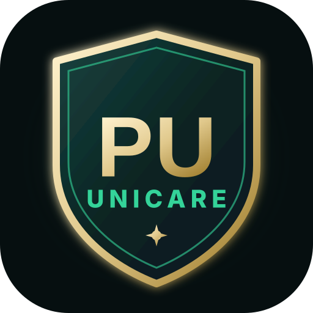

# 🏫 PU UNICARE — Parul University Campus Maintenance Platform

<p align="center">
  
</p>

<p align="center">
  <strong>Next-Generation AI-Powered Facility Resolution, Live SLA Tracking & Smart Campus Maintenance</strong><br>
  <em>Official Platform for Parul University • Vadodara, Gujarat</em>
</p>

<p align="center">
  
  
  
  
  
  
  
  
</p>

---

## 🌟 Overview

**PU UNICARE** is a centralized, AI-driven maintenance platform engineered specifically for **Parul University's** 150+ acre campus. It replaces slow, error-prone manual registers with instant voice filing, automated ticket routing, real-time technician dispatching, smart SLA tracking, and multilingual accessibility across **English, Hindi (हिन्दी), and Gujarati (ગુજરાતી)**.

---

## ✨ Key Platform Highlights

### 🎙️ 1. Multilingual AI Voice Instant Complaint
- Speak naturally in **Hindi**, **Gujarati**, **English**, or mixed Hinglish/Gujlish.
- Automatic speech recognition (ASR) extracts the **Category** (HVAC, Electrical, Plumbing, IT), **Building**, **Room/Location**, **Priority**, and **Description** in real time.
- 1-click preview and evidence attachment before final submission.

### 📱 2. Progressive Web App (PWA) & Offline Mode
- Native app installation on **Android, iOS, Windows, and macOS**.
- High-res adaptive icons (`icon-192.png`, `icon-512.png`, maskable and Apple touch icons).
- Service worker caching (`sw.js`) enables offline browsing of campus directories and cached ticket statuses.
- Real-time online/offline network indicator.

### 🧭 3. Authentic Campus Spatial Mapping
- 150+ mapped buildings and facilities aligned with the official Parul University Campus Map:
  - **Academic Blocks**: PIET (A1), PIT (A4), Pharmacy, Applied Sciences, Architecture, Law.
  - **Healthcare**: Parul Sevashram Hospital & Medical College (E1).
  - **Hostels**: Dr. A.P.J. Abdul Kalam Bhawan (H1), Kalpana Chawla Bhawan (H2), Mother Teresa, Tagore.
  - **Dining & Plazas**: Main Campus Food Court (F1), Management Food Court (F2), North Campus Plaza.

### ⌨️ 4. Quick Command Navigator (`⌘K` / `Ctrl+K`)
- Spotlight keyboard launcher for instant navigation to any campus hotspot, role dashboard, language switcher, or instant AI tools.

### 🌟 5. On-Screen Interactive Guided Tour
- 10-step animated onboarding tour highlighting AI voice filing, chatbot assistance, ticket filters, and technician workflows.

### ⚡ 6. Zero Layout Shift Skeleton Loading
- Custom shimmering skeleton loader suite (`src/components/ui/skeleton.tsx`) providing instant visual feedback across all 20+ dashboards.

---

## 👥 The 6 User Roles & Permissions

| Role | Core Capabilities |
| :--- | :--- |
| **Faculty** | Submit complaints, track status, verify repair completion, provide satisfaction ratings. |
| **Class Representative (CR)** | File classroom and lab complaints on behalf of students with rapid category tagging. |
| **Maintenance Staff** | Real-time work order feeds, state progression (Assigned → In Progress → Resolved), photo proof upload. |
| **Head of Department (HOD)** | Departmental queue monitoring, manual technician assignment, SLA deadline oversight. |
| **Principal / Campus Leadership** | University-wide KPI analytics, delayed ticket escalation, CSV/PDF compliance reports. |
| **System Administrator** | User role assignment, building/room catalog management, SMS/Email gateway settings. |

---

## 🛠️ Tech Stack & Architecture

```
PU UNICARE ARCHITECTURE
├── Client Tier (React 18 + TypeScript + Vite + TailwindCSS + Framer Motion)
│   ├── PWA Layer (Manifest, Service Worker, Cache API, Offline Sync)
│   ├── Multilingual Layer (i18next: EN / HI / GU)
│   └── UI Suite (Radix UI, Lucide Icons, Shimmering Skeletons)
├── Intelligence Tier
│   ├── Google Gemini API (Category detection, sentiment & diagnostic analysis)
│   └── Web Speech API (Multilingual continuous speech recognition)
├── Data & Realtime Tier (Supabase)
│   ├── PostgreSQL with Row-Level Security (RLS)
│   ├── Realtime WebSockets (Live complaint status updates)
│   └── Supabase Storage (Photo proof of completed repairs)
└── Messaging Tier
    ├── Fast2SMS API (Indian campus mobile SMS alerts)
    └── Resend / SMTP (Staff & Faculty notification digests)
```

---

## 🚀 Quick Start Guide

### 1. Prerequisites
- **Node.js** (v18.x or v20.x recommended)
- **npm** or **pnpm**
- **Git**

### 2. Clone & Install
```bash
git clone https://github.com/jaiswalshubham8145/PU-UNICARE.git
cd PU-UNICARE
npm install
```

### 3. Environment Setup
Create a `.env` file in the root directory:
```env
VITE_SUPABASE_URL=https://your-project.supabase.co
VITE_SUPABASE_PUBLISHABLE_KEY=your-anon-key
VITE_GEMINI_API_KEY=your-gemini-key
VITE_FAST2SMS_API_KEY=your-sms-key
```

### 4. Run Development Server
```bash
npm run dev
```
Open **[http://localhost:8080](http://localhost:8080)** in your browser.

### 5. Automated Tests & Code Quality
```bash
# Run Vitest unit tests (43 tests)
npx vitest run

# Run ESLint check
npm run lint

# Build production bundle
npm run build
```

---

## 📂 Project Directory Structure

```
c:\PU unicare\
├── public/                 # PWA icons, manifest.json, sw.js, screenshots
├── scripts/                # Utility scripts (PWA generator, DB seeds)
├── src/
│   ├── components/
│   │   ├── chat/           # ChatWidget & VoiceComplaintAssistant
│   │   ├── common/         # CommandPalette (⌘K)
│   │   ├── dashboard/      # Analytics, user management, staff dispatch
│   │   ├── home/           # HeroSection, CampusPulse, DiagnosticSimulator
│   │   ├── layout/         # Navbar, Footer, LanguageSwitcher, ThemeToggle
│   │   ├── pwa/            # PWAInstallBanner, OfflineIndicator
│   │   ├── tour/           # Interactive guided tour suite
│   │   └── ui/             # Radix primitives & skeleton loaders
│   ├── data/               # Parul University campus buildings directory
│   ├── hooks/              # useAuth, useComplaints, usePWAInstall, useTheme, etc.
│   ├── integrations/       # Supabase typed client & database definitions
│   ├── pages/              # Role dashboards & feature views
│   ├── services/           # AIService, SMSService, emailService, EscalationService
│   └── test/               # Vitest unit & integration test suites
├── supabase/               # SQL migrations, RLS policies, triggers
├── package.json
├── tailwind.config.ts
└── vite.config.ts
```

---

## 📚 Detailed Documentation

- 🌟 **[ALL_FEATURES.md](./ALL_FEATURES.md)** — Exhaustive feature inventory across all 20+ modules.
- 📘 **[ABOUT_PROJECT.md](./ABOUT_PROJECT.md)** — Plain-English guide for faculty, students, and administration.
- 🛠️ **[ABOUT_PROJECT_TECHNICAL.md](./ABOUT_PROJECT_TECHNICAL.md)** — Technical deep dive, database ER schema, and algorithms.

---

## 🛡️ License

Developed for **Parul University Maintenance & Facility Management Cell**. All rights reserved.
