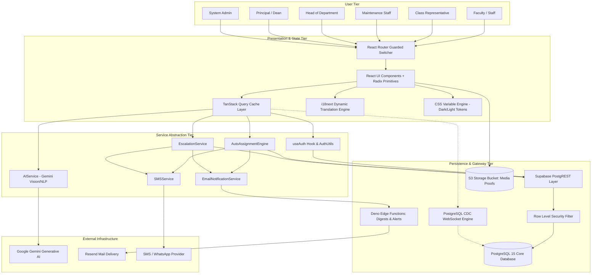
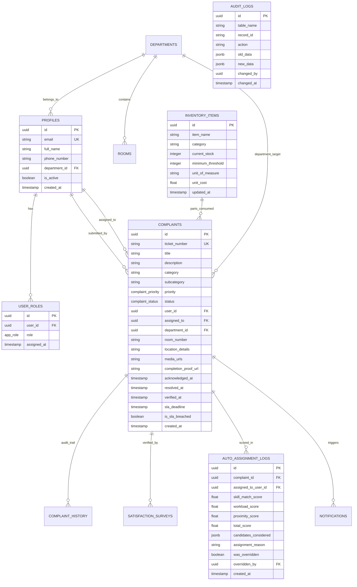

# 🛠️ PU UNICARE — Comprehensive Technical Architecture & Engineering Documentation

> **Target Platform:** Parul University Maintenance Management System  
> **Repository:** `PU-UNICARE`  
> **System Architecture Version:** 2.1.0 (Production Architecture)  
> **Document Purpose:** Complete technical reference, engineering specifications, database schemas, algorithmic logic, and architecture diagrams.

---

## 📑 Technical Table of Contents

1. [Architectural Overview & Engineering Principles](#1-architectural-overview--engineering-principles)
2. [Full Technology Stack & Dependencies](#2-full-technology-stack--dependencies)
3. [System Architecture Diagram (C4 Component Model)](#3-system-architecture-diagram-c4-component-model)
4. [Database Schema & Entity Relationship Diagram (ERD)](#4-database-schema--entity-relationship-diagram-erd)
5. [Row-Level Security (RLS) & Access Control Matrix](#5-row-level-security-rls--access-control-matrix)
6. [Core Computational & Algorithmic Engines](#6-core-computational--algorithmic-engines)
   - 6.1 [Auto-Assignment Scoring Algorithm (`AutoAssignmentEngine.ts`)](#61-auto-assignment-scoring-algorithm)
   - 6.2 [SLA Breach & Escalation State Machine (`EscalationService.ts`)](#62-sla-breach--escalation-state-machine)
   - 6.3 [Multimodal AI Categorization Pipeline (`AIService.ts`)](#63-multimodal-ai-categorization-pipeline)
7. [Frontend Architecture & State Topology](#7-frontend-architecture--state-topology)
8. [Event Driven Notification & Webhook Subsystem](#8-event-driven-notification--webhook-subsystem)
9. [Security, Audit Logging & Compliance](#9-security-audit-logging--compliance)
10. [Local Development, Build Optimization & Deployment](#10-local-development-build-optimization--deployment)

---

## 1. Architectural Overview & Engineering Principles

**PU UNICARE** is architected as an event-driven, cloud-native facility management engine engineered for high availability, sub-second latency, and deterministic state tracking across complex organizational hierarchies.

```
┌────────────────────────────────────────────────────────────────────────┐
│                          CLIENT APPLICATION TIER                       │
│     React 18.3 (SPA) • TypeScript 5.8 • Tailwind CSS • Vite Bundler    │
│     TanStack Query v5 • Radix UI • Framer Motion • Leaflet Maps        │
└───────────────────────────────────┬────────────────────────────────────┘
                                    │ HTTPS (RESTful / RPC via PostgREST)
                                    │ WSS (PostgreSQL Replication CDC)
┌───────────────────────────────────▼────────────────────────────────────┐
│                    EDGE GATEWAY & BACKEND AS A SERVICE                 │
│                 Supabase Cloud / PostgreSQL 15.1 Engine                │
├───────────────────────────────────┬────────────────────────────────────┤
│  Supabase Auth (JWT / RS256)      │  Supabase Edge Functions (Deno v1) │
│  Row-Level Security (RLS) Engine  │  Cron Automation Engines (pg_cron) │
│  Storage S3 Compatible Buckets    │  PostgREST Query Dispatcher        │
└───────────────────────────────────┬────────────────────────────────────┘
                                    │
┌───────────────────────────────────▼────────────────────────────────────┐
│                       EXTERNAL INTEGRATION FABRIC                      │
│   • Google Gemini Generative AI API   • Resend / SMTP Email Gateway    │
│   • SMS / WhatsApp Telephony Webhooks • Cloudflare CDN Asset Edge      │
└────────────────────────────────────────────────────────────────────────┘
```

### Core Design Principles:
- **Zero Trust Security Model**: Authorization is verified at both the UI route guard and enforced cryptographically at the database table layer using PostgreSQL Row-Level Security (RLS) policies.
- **Optimistic State Synchronization**: Mutations execute optimistically in TanStack React Query cache with rollback mechanisms, coupled to PostgreSQL Change Data Capture (CDC) over WebSockets.
- **Fail-Safe Offline Resilience**: Service Worker integration unregisters gracefully in local development while caching asset bundles and queuing submissions in production PWA deployments.
- **Determinism in Escalation**: Ticket status progression is governed by an immutable finite state machine enforced via relational constraints and database triggers.

---

## 2. Full Technology Stack & Dependencies

### Frontend Core & Compiler
| Technology | Version | Purpose in Architecture |
| :--- | :--- | :--- |
| **React** | `^18.3.1` | Concurrent component rendering, reconciliation tree |
| **TypeScript** | `^5.8.0` | Strict static typing, generic schema validation |
| **Vite** | `^5.4.19` | ES module dev server, Rollup bundle pipeline |
| **TanStack React Query** | `^5.83.0` | Asynchronous cache invalidation, background refetching |
| **React Router DOM** | `^6.30.1` | Client-side routing, protected role route guards |

### UI, Styling & Motion
| Technology | Version | Purpose in Architecture |
| :--- | :--- | :--- |
| **Tailwind CSS** | `^3.4.17` | Utility-first styling engine with HSL CSS variables |
| **Radix UI Primitives**| `1.x - 2.x` | Accessible, unstyled ARIA-compliant component primitives |
| **Framer Motion** | `^12.29.0` | Hardware-accelerated layout transitions & keyframe springs |
| **Lucide React** | `^0.462.0` | Vector icon system matching design tokens |
| **Sonner & Toaster** | `^1.7.4` | Non-blocking reactive toast notifications |

### Analytical, Mapping & Document Engines
| Technology | Version | Purpose in Architecture |
| :--- | :--- | :--- |
| **Recharts** | `^2.15.4` | Responsive SVG time-series, bar, and doughnut charts |
| **Leaflet & React-Leaflet** | `^1.9.4` | Interactive campus geolocation & building heatmaps |
| **html5-qrcode** | `^2.3.8` | Mobile camera hardware QR code scanning engine |
| **jsPDF & AutoTable** | `^4.0.0` | Client-side dynamic vector PDF generation for audits |
| **XLSX & PapaParse** | `^0.18.5` | High-throughput spreadsheet parsing and CSV export |

### Backend, Database & Edge Runtime
| Technology | Version | Purpose in Architecture |
| :--- | :--- | :--- |
| **Supabase JS Client** | `^2.88.0` | Typed PostgREST query client, WebSocket subscriptions |
| **PostgreSQL** | `15.1` | Relational ACID database with JSONB and PostGIS |
| **Deno Edge Functions**| `1.x` | Serverless TypeScript functions for digests and alerts |
| **Google Generative AI**| `^0.24.1` | Gemini Pro / Vision API client for automated triage |

---

## 3. System Architecture Diagram (C4 Component Model)



---

## 4. Database Schema & Entity Relationship Diagram (ERD)

The database schema is structured in strict 3NF (Third Normal Form) with JSONB support for semi-structured log telemetry and candidate evaluation scoring metrics.



### Enumeration Definitions
```sql
CREATE TYPE app_role AS ENUM (
    'admin',
    'principal',
    'hod',
    'faculty',
    'cr',
    'maintenance_staff'
);

CREATE TYPE complaint_status AS ENUM (
    'pending',
    'assigned',
    'in_progress',
    'on_hold',
    'resolved',
    'verified',
    'rejected'
);

CREATE TYPE complaint_priority AS ENUM (
    'low',
    'medium',
    'high',
    'critical'
);
```

---

## 5. Row-Level Security (RLS) & Access Control Matrix

Every SQL query sent from the frontend client executes within the context of the user's validated JWT token (`auth.uid()`). Database triggers evaluate role claims via helper functions to permit or restrict operations:

```sql
-- Role verification database helper function
CREATE OR REPLACE FUNCTION public.has_role(user_id uuid, required_role app_role)
RETURNS boolean AS $$
BEGIN
    RETURN EXISTS (
        SELECT 1 FROM public.user_roles 
        WHERE user_roles.user_id = $1 AND user_roles.role = $2
    );
END;
$$ LANGUAGE plpgsql SECURITY DEFINER;
```

### Role Access Control Matrix
| Feature / Operation | Faculty | Class Rep | Staff | HOD | Principal | Admin |
| :--- | :---: | :---: | :---: | :---: | :---: | :---: |
| **Insert Complaint** | ✅ | ✅ | ❌ | ✅ | ✅ | ✅ |
| **Read Own Department Complaints** | ✅ | ✅ | ✅ | ✅ | ✅ | ✅ |
| **Read All Campus Complaints** | ❌ | ❌ | ❌ | ❌ | ✅ | ✅ |
| **Update Complaint Status (In-Progress)**| ❌ | ❌ | ✅ | ✅ | ✅ | ✅ |
| **Upload Completion Proof** | ❌ | ❌ | ✅ | ❌ | ❌ | ✅ |
| **Verify & Sign-off Completion** | ✅ | ❌ | ❌ | ✅ | ✅ | ✅ |
| **Reassign Technician** | ❌ | ❌ | ❌ | ✅ | ✅ | ✅ |
| **View Financial / SLA Analytics**| ❌ | ❌ | ❌ | Dept Only | Campus-wide | Full |
| **Modify Inventory Levels** | ❌ | ❌ | Consume | ❌ | ❌ | Manage |
| **User & Role Administration** | ❌ | ❌ | ❌ | ❌ | ❌ | ✅ |

---

## 6. Core Computational & Algorithmic Engines

### 6.1 Auto-Assignment Scoring Algorithm

Implemented in [src/services/AutoAssignmentEngine.ts](file:///c:/PU%20unicare/src/services/AutoAssignmentEngine.ts), this engine calculates a multi-factor weighted score to automatically pair an incoming ticket with the optimal maintenance technician.

$$\text{TotalScore} = (W_S \times S_{\text{skill}}) + (W_W \times S_{\text{workload}}) + (W_P \times S_{\text{proximity}})$$

Where weights are calibrated to:
- **$W_S = 0.40$ (Skill Compatibility Weight)**
- **$W_W = 0.40$ (Workload Distribution Weight)**
- **$W_P = 0.20$ (Location Proximity Weight)**

```typescript
// Auto-Assignment Logic Excerpt
const calculateCandidateScore = (
  candidate: StaffProfile,
  complaint: ComplaintPayload
): CandidateEvaluation => {
  // 1. Skill Match Score (0.0 to 1.0)
  const skillMatch = candidate.skills.includes(complaint.category) ? 1.0 : 0.2;
  
  // 2. Workload Leveling Score (Inverse ratio of active queue)
  const maxQueue = 10;
  const currentLoad = candidate.active_tickets_count;
  const workloadScore = Math.max(0, (maxQueue - currentLoad) / maxQueue);
  
  // 3. Proximity Score (Same building = 1.0, same campus = 0.6, other = 0.2)
  const proximityScore = candidate.current_building === complaint.building 
    ? 1.0 
    : (candidate.campus === complaint.campus ? 0.6 : 0.2);

  const totalScore = (skillMatch * 0.40) + (workloadScore * 0.40) + (proximityScore * 0.20);

  return {
    userId: candidate.id,
    skillMatch,
    workloadScore,
    proximityScore,
    totalScore
  };
};
```

---

### 6.2 SLA Breach & Escalation State Machine

Governed by [src/services/EscalationService.ts](file:///c:/PU%20unicare/src/services/EscalationService.ts) and triggered by background database jobs:

```
                  ┌──────────────────────┐
                  │ Complaint Submitted  │
                  └──────────┬───────────┘
                             │
                      [TTA: 2 Hours]
                             ▼
                 Was Ticket Acknowledged?
                 ├── YES ──► Progress to Execution (TTR Clock Active)
                 └── NO
                      │
                      ▼
         ┌───────────────────────────────┐
         │     LEVEL 1 ESCALATION        │
         │ Automated Alert Sent to HOD   │
         └────────────┬──────────────────┘
                      │
               [TTR: 24 Hours]
                      ▼
               Was Issue Resolved?
               ├── YES ──► Move to Faculty Verification
               └── NO
                      │
                      ▼
         ┌───────────────────────────────┐
         │     LEVEL 2 ESCALATION        │
         │ Alert Dispatched to Principal │
         │   & Highlighted on Dashboard  │
         └───────────────────────────────┘
```

---

### 6.3 Multimodal AI Categorization Pipeline

Implemented in [src/services/AIService.ts](file:///c:/PU%20unicare/src/services/AIService.ts) using `@google/generative-ai` (`gemini-1.5-flash`):
1. **Input**: User complaint textual description + optional base64 image payload from camera.
2. **Analysis**:
   - Parses physical equipment failure signatures (e.g. electrical burn, HVAC water leakage, broken hinge).
   - Maps input to canonical schema (`category`, `subcategory`, `suggestedPriority`, `estimatedResolutionHours`).
3. **Output**: Strongly-typed JSON parsed against Zod schema with instant fallback to standard rule-based heuristics if offline or quota-limited.

---

## 7. Frontend Architecture & State Topology

### Global State & Cache Invalidation
The application leverages **TanStack React Query v5** for server-state caching, eliminating redundant network calls while maintaining sub-second UI responsiveness:

```
Query Key Taxonomy:
• ['complaints', { status, department, role }]
• ['complaint', ticketId]
• ['notifications', userId]
• ['inventory', { category, lowStock }]
• ['analytics', { timeframe, departmentId }]
• ['staff-directory', { departmentId, onDuty }]
```

When mutations occur (e.g., ticket status change, comment added, proof uploaded):
```typescript
queryClient.invalidateQueries({ queryKey: ['complaints'] });
queryClient.invalidateQueries({ queryKey: ['analytics'] });
```

### Styling Token Architecture (`index.css` & `tailwind.config.ts`)
The color system operates via CSS custom properties mapped in HSL format for instant dark/light switching:
- **`--primary`**: `156 75% 52%` (Luminous Radiant Emerald `#34D399`)
- **`--gold`**: `40 50% 58%` (Regal Brass Gold `#C2A05A`)
- **`--background` (Dark)**: `186 45% 4.3%` (Deep Midnight `#060F10`)
- **`--background` (Light)**: `43 54% 92.4%` (Warm Academic Parchment)

---

## 8. Event Driven Notification & Webhook Subsystem

The platform implements multi-channel broadcast fan-out upon state transitions:

```
               [ State Change Event ]
               (e.g., 'STATUS_RESOLVED')
                          │
         ┌────────────────┼────────────────┐
         ▼                ▼                ▼
[ In-App Realtime ]  [ Email Engine ]  [ SMS Gateway ]
  WebSockets via      Edge Function:     Twilio / HTTP
  Supabase CDC        `send-email`       REST Webhook
  Channels            via Resend API     Template Dispatch
```

### Notification Payload Schema:
```typescript
interface NotificationEvent {
  recipientId: string;
  type: 'assignment' | 'status_update' | 'sla_warning' | 'completion';
  title: string;
  message: string;
  ticketId: string;
  actionUrl: string;
  metadata: {
    priority: 'low' | 'medium' | 'high' | 'critical';
    previousStatus: string;
    newStatus: string;
  };
}
```

---

## 9. Security, Audit Logging & Compliance

### 1. Cryptographic Authentication
- Sessions authenticated via Supabase GoTrue JWT tokens with 1-hour expiration and silent sliding-window refresh tokens.
- Passwords salted and hashed with `bcrypt` (cost factor 10+).

### 2. Immutable Audit Trail
Any `UPDATE` or `DELETE` operation executed on critical tables automatically triggers a PostgreSQL trigger inserting into `audit_logs`:
```sql
CREATE OR REPLACE FUNCTION process_audit_log()
RETURNS TRIGGER AS $$
BEGIN
    INSERT INTO public.audit_logs (
        table_name,
        record_id,
        action,
        old_data,
        new_data,
        changed_by,
        changed_at
    ) VALUES (
        TG_TABLE_NAME,
        COALESCE(NEW.id, OLD.id),
        TG_OP,
        to_jsonb(OLD),
        to_jsonb(NEW),
        auth.uid(),
        NOW()
    );
    RETURN NEW;
END;
$$ LANGUAGE plpgsql SECURITY DEFINER;
```

### 3. XSS & Injection Sanitization
- All dynamically rendered user HTML/Markdown is sanitized through `DOMPurify`.
- Database access exclusively leverages parameterized queries via PostgREST, preventing SQL injection vectors entirely.

---

## 10. Local Development, Build Optimization & Deployment

### Build Optimization Profile (`vite.config.ts`)
The production build pipeline enforces chunk splitting to maintain initial JavaScript bundles under 300 kB:
```typescript
build: {
  rollupOptions: {
    output: {
      manualChunks: {
        'vendor-react': ['react', 'react-dom', 'react-router-dom'],
        'vendor-ui': ['@radix-ui/react-dialog', '@radix-ui/react-dropdown-menu', 'sonner'],
        'vendor-motion': ['framer-motion'],
        'vendor-charts': ['recharts'],
        'vendor-query': ['@tanstack/react-query'],
      }
    }
  }
}
```

### Environment Matrix (`.env`)
```env
# Supabase Connectivity
VITE_SUPABASE_URL=https://<your-project-id>.supabase.co
VITE_SUPABASE_ANON_KEY=eyJhbGciOiJIUzI1NiIsInR5cCI6IkpXVCJ9...

# Optional AI & Third-Party Keys
VITE_GEMINI_API_KEY=AIzaSy...
VITE_APP_URL=http://localhost:8080
```

### Verification & Test Automation Commands
```bash
# 1. Install all dependencies
npm install

# 2. Run local development server
npm run dev

# 3. Static type-checking and production compilation
npm run build

# 4. Execute unit test suite (Vitest)
npm run test

# 5. Execute End-to-End browser test suite (Playwright)
npm run test:e2e
```

---

*Technical architecture document maintained for the Parul University Maintenance Management System.*  
*Engineering Team • All rights reserved.*
