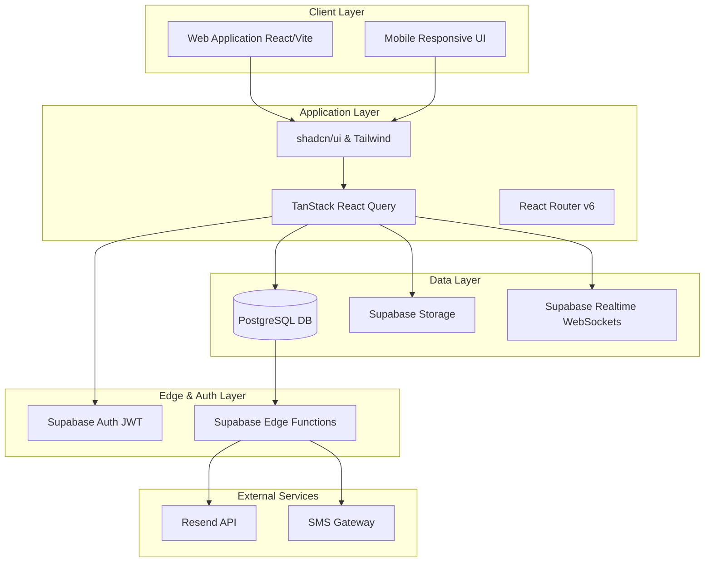
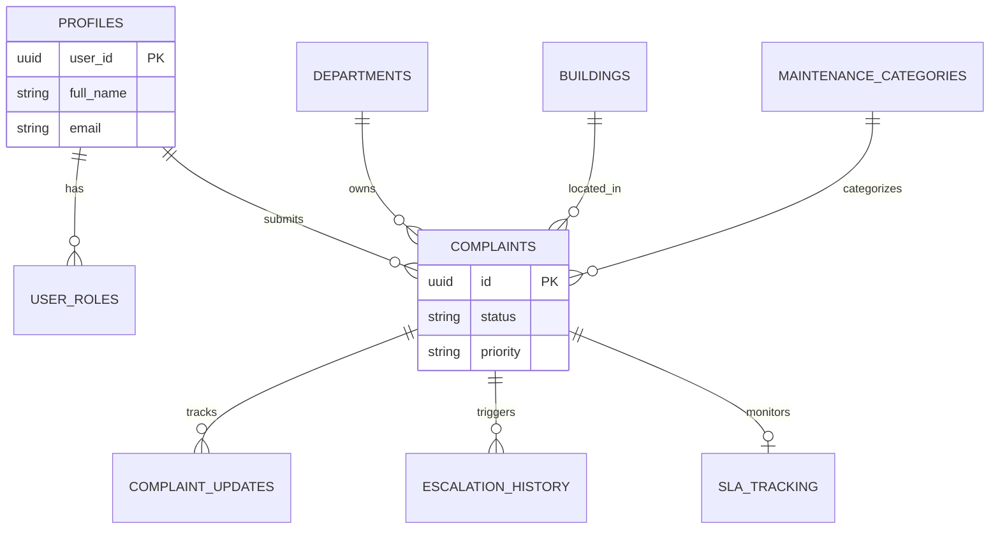
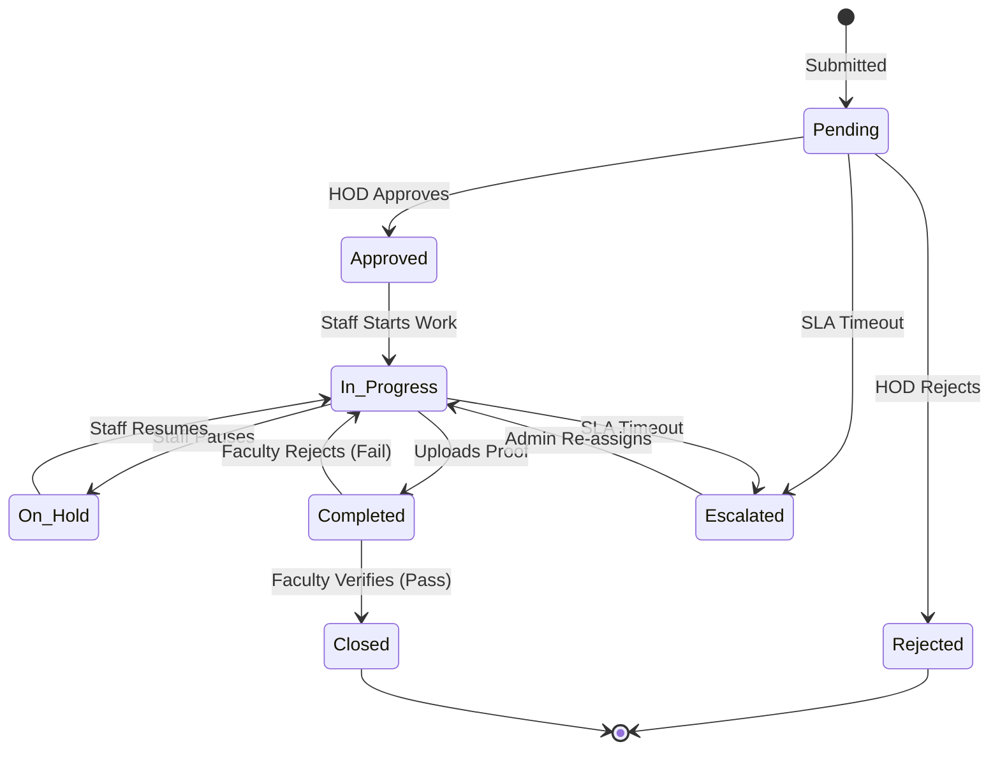
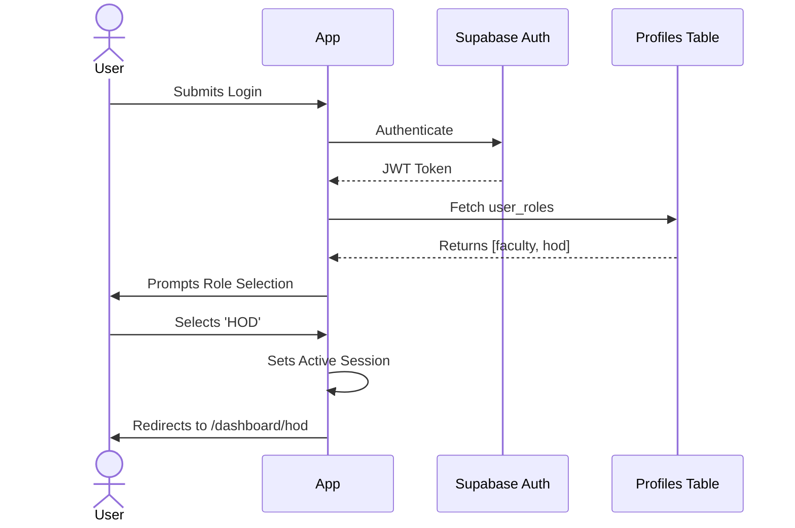

# 🌟 PU UNICARE Documentation Presentation

Welcome to the final, comprehensive presentation of the **PU Unicare Enterprise Maintenance & Facility Management System**. 

Use the carousel below to interactively explore the system architecture, database schemas, automated lifecycles, and role-based flows.

````carousel
## 1. Executive Summary & Vision

**PU UNICARE** is a centralized, AI-powered digital maintenance complaint management platform. 

> [!TIP]
> **Expected Institutional ROI:**
> - Administrative Workload Reduced by 75%
> - Resolution Time Frame Decreased by 60%
> - SLA Compliance Rate Maintained at >98%
> - Infrastructure Lifespan Increased by 25%

*Swipe to the next slide to view the system architecture.*
<!-- slide -->
## 2. System Architecture

The architecture separates concerns into a React-based frontend, a Supabase (PostgreSQL) backend, and a real-time event-driven notification layer.


<!-- slide -->
## 3. Database Schema

The core relational structure mapping Profiles, Complaints, and Departments, secured by PostgreSQL Row-Level Security (RLS).


<!-- slide -->
## 4. The Complaint Lifecycle

Every complaint follows a strict, state-machine driven lifecycle monitored by the SLA Engine.


<!-- slide -->
## 5. AI Auto-Assignment Engine

When a complaint is approved, the local heuristic algorithm instantly assigns the best technician without human intervention.

> [!NOTE]
> **The Scoring Algorithm:**
> `Total Score = (Skill Match * 50%) + (Workload Capacity * 35%) + (Physical Proximity * 15%)`

This ensures that tasks are routed evenly, and urgent safety hazards are prioritized automatically.
<!-- slide -->
## 6. Access Control & Navigation Flow

Strict Role-Based Access Control (RBAC) ensures users only see what they are permitted to.


````

For the full, raw text documentation, please refer to the repository file: [PU_UNICARE_MASTER_DOCUMENTATION.md](file:///c:/PU%20unicare/PU_UNICARE_MASTER_DOCUMENTATION.md)
