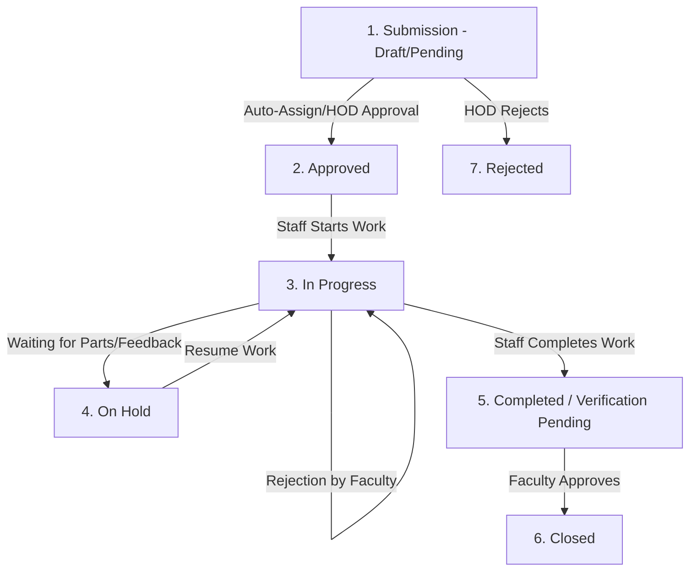

# 📱 PU UNICARE - Complete System Brief & Feature Handbook

Welcome to the **PU UNICARE** Handbook. This document provides a highly detailed, comprehensive, and modular overview of every feature, dashboard, automated trigger, database table, and service within the PU UNICARE platform down to the smallest detail.

---

## 🗺️ 1. Executive System Overview

**PU UNICARE** is an enterprise-grade, centralized, role-based Maintenance Management System (CMMS) custom-engineered for university ecosystems. It transitions manual facility reporting into an automated, AI-assisted, and SLA-compliant workflow.

### 👥 The 6 Role Profiles & Access Rights

| Role | Access Level | Description & Core Responsibilities |
| :--- | :--- | :--- |
| **Faculty** | **Basic** | Submit complaints, monitor personal complaints, verify completed work, and provide a 5-dimension rating. |
| **CR (Class Representative)** | **Basic** | Submit and monitor maintenance complaints on behalf of students in specific rooms/floors. |
| **Maintenance Staff** | **Operational** | Access assigned queues, start/pause/complete tasks, post progress notes, and upload before/after completion photos. |
| **HOD (Head of Dept.)** | **Departmental** | Approve or reject complaints, manually assign tasks, trigger AI auto-assignments, and view department metrics. |
| **Principal** | **University-wide** | Monitor campus-wide operations, view delayed complaints, analyze department SLA performance, and export PDF reports. |
| **Admin** | **Full Control** | Manage departments, modify global SLA & escalation thresholds, update roles, perform bulk actions, and oversee logs. |

---

## 🎨 2. System Dashboards & User Actions

PU UNICARE features **6 custom-built, responsive dashboards** containing tailored visual metrics and action blocks:

### 2.1 Faculty Dashboard
*   **Awaiting Verification Alert:** High-contrast notification banner highlighting complaints that have been completed by staff but require faculty approval.
*   **Key Action Blocks:**
    *   *Smart Complaint Wizard:* Launches form with real-time AI assistance.
    *   *Feedback & Verify:* Faculty reviews before/after images and rates the service across 5 dimensions.
*   **Analytics Grid:** 4 KPI cards track *Total registered, Pending approval, In progress,* and *Completed*.

### 2.2 CR (Class Representative) Dashboard
*   **CR Info Banner:** Customized panel guiding CRs on how to report issues affecting student classes.
*   **Page Layout:** Clean list of complaints registered by the CR with advanced sorting and tracking filters.

### 2.3 HOD Dashboard
*   **Departmental Console:** Displays real-time metrics of the HOD's department (e.g., Department of Computer Engineering).
*   **Critical Alerts:** High-priority flashing cards indicating complaints requiring immediate dispatch.
*   **Interactive Queues:**
    *   *Approve & Assign:* HOD can review the AI suggested technician or override and pick manually.
    *   *Rejection Panel:* Reject spam/duplicate complaints with mandatory reasoning.

### 2.4 Principal Dashboard
*   **University Analytics Console:**
    *   *Department Performance Chart:* Bar chart of complaint volume vs. resolution rate.
    *   *Status Distribution:* Pie charts of active workload.
*   **Delayed/Escalated Filters:** Visual lists highlighting every complaint that has breached its SLA or escalated.

### 2.5 Admin Dashboard
*   **System Configuration Hub:**
    *   *Overview Tab:* System-wide charts and database wellness metrics.
    *   *Departments Tab:* CRUD module to manage campus divisions.
    *   *SLA Rules Tab:* Interface to configure custom response, resolution, and escalation thresholds.
*   **User Management:** Edit role records and toggle developer/administrative capabilities.

### 2.6 Maintenance Staff Dashboard
*   **Task Board:** Workload split into 4 clear statuses: *New Assigned, In Progress, On Hold, and Completed*.
*   **Overdue Indicators:** Highlighting tasks that are nearing or have breached their deadline.
*   **Action Drawer:**
    *   *Start Work:* Move status to `in_progress`.
    *   *Progress Update:* File mid-task updates with percent completion sliders and status notes.
    *   *On Hold:* Pause task with mandatory justification (e.g., "waiting for spare parts").
    *   *Submit Proof:* Complete task by uploading before/after photos and closing notes.

---

## 🔄 3. Detailed Complaint Lifecycle

Every complaint flows through a rigorous state machine from inception to closure:



### State Definitions & Database Keys
1.  **Pending (`pending`):** Newly submitted; awaiting HOD validation (if auto-assignment is off or failed).
2.  **Rejected (`rejected`):** Disapproved by HOD. Lifecycle ends.
3.  **Approved (`approved`):** Validated and assigned to a technician. Awaiting staff to click "Start".
4.  **In Progress (`in_progress`):** Staff is actively working on the resolution.
5.  **On Hold (`on_hold`):** Temporarily paused due to external dependencies.
6.  **Completed (`completed`):** Technician finished work and uploaded proof. Awaiting submitter review.
7.  **Closed (`closed`):** Submitter verified completion. Star ratings logged.

---

## 🤖 4. AI & Automation Services

PU UNICARE employs localized AI services to streamline routing and categorization.

### 4.1 AI Natural Language Processor (`AIService.ts`)
When text is entered, the engine calculates probabilities:
*   **Auto-Categorization:** Maps descriptions against pre-configured arrays to select categories:
    *   *Plumbing:* leak, water, pipe, tap, toilet, sink, flooding.
    *   *Electrical:* light, electric, socket, wire, fan, AC, fuse, voltage.
    *   *Carpentry:* door, window, furniture, chair, desk, lock.
    *   *Cleaning:* dirty, garbage, sweep, smell, pest, cockroach.
    *   *IT Support:* internet, wifi, network, printer, projector, lan.
*   **Smart Priority Scorer:**
    *   *Critical words (Danger, fire, flood, life threatening, emergency)* = Weight 100
    *   *High words (broken, not working, major, exam)* = Weight 75
    *   Scores above 200 trigger automatic **Critical** priority; scores above 100 trigger **High** priority.
*   **Title Summarization:** Automatically trims long text descriptions into a concise header (max 8 words + "...").

### 4.2 Auto-Assignment Engine (`AutoAssignmentEngine.ts`)
The auto-assignment engine calculates a score for each technician using a weighted multi-criteria formula:

$$\text{Total Score} = (\text{Skill Match} \times 0.50) + (\text{Workload Capacity} \times 0.35) + (\text{Physical Proximity} \times 0.15)$$

*   **Skill Score (50% weight):** Technician proficiency level (1 to 5) in the category.
*   **Workload Score (35% weight):** Calculated as $1 - (\text{current active tasks} / \text{maximum workload})$.
*   **Proximity Score (15% weight):** Uses the **Haversine formula** to measure distance from the technician's last coordinate to the building:
    $$d = 2R \arcsin \left( \sqrt{\sin^2\left(\frac{\Delta \text{lat}}{2}\right) + \cos(\text{lat}_1)\cos(\text{lat}_2)\sin^2\left(\frac{\Delta \text{lon}}{2}\right)} \right)$$
*   **Fallback Protocol:** If no department staff match, the engine queries university-wide staff with a 30% score penalty.
*   **Emergency Mode:** For critical priority, proximity is bypassed to assign the absolute highest-skilled worker.

---

## ⏳ 5. SLA & Escalation Engine

To guarantee service reliability, PU UNICARE enforces Service Level Agreements (SLAs) and automated escalations.

### 5.1 SLA Threshold Rules

| Priority | First Response Deadline | Expected Resolution Time | Escalation Check Window |
| :--- | :--- | :--- | :--- |
| **Critical** | 2 Hours | 24 Hours | 12 Hours |
| **High** | 8 Hours | 48 Hours | 24 Hours |
| **Medium** | 24 Hours | 72 Hours | 48 Hours |
| **Low** | 48 Hours | 120 Hours | 72 Hours |

*Note: The SLA calculator supports Business Hours (Mon-Fri 09:00 - 17:00) and dynamically skips university holidays.*

### 5.2 Automated Escalation Flow
A backend daemon evaluates active complaints hourly. If thresholds are breached:
1.  **Level 1 Escalation:** Pending/unassigned past deadline is escalated to the **HOD**.
2.  **Level 2 Escalation:** Unresolved after Level 1 is escalated to the **Principal**.
3.  **Level 3 Escalation:** Reaches maximum escalation level, flagged directly to the **Admin**.
*   *Actions:* The database flags `is_resolution_breached`, writes to the `escalation_history` table, sends alert emails, and pushes a real-time notification to the relevant supervisor's dashboard.

---

## 📧 6. Email & Notification Matrix

The system maps lifecycle events to 20+ custom HTML email templates powered by **Resend API via Supabase Edge Functions**:

| Email Event | Sender Header Style | Recipients | Trigger Event |
| :--- | :--- | :--- | :--- |
| `complaint_submitted` | Green Border | Submitter, HOD | Complaint successfully inserted. |
| `complaint_assigned` | Purple Border | Submitter, Tech | Staff member assigned to complaint. |
| `work_started` | Green Border | Submitter | Technician clicks "Start Work". |
| `progress_update` | Cyan Border | Submitter, HOD | Technician posts progress update. |
| `work_on_hold` | Yellow Border | Submitter | Technician pauses task (parts delay). |
| `completion` | Green Border | Submitter | Tech uploads completion photos. |
| `verification_rejected`| Red Border | Technician | Submitter rejects completion. |
| `sla_breach` | Double Red Border| HOD, Admins | Complaint breaches SLA deadline. |
| `escalated` | Solid Red Border | Supervisor | SLA breach threshold triggers escalation. |
| `digest` | Slate Blue Header| HODs, Admins | Scheduled digests (Morning/Evening/Weekly). |

---

## 🗄️ 7. Core Database Schema Overview

The database runs on PostgreSQL (via Supabase) with Row-Level Security (RLS) enabled on all tables:

```
[profiles]
   ├── user_id (PK)
   ├── email
   ├── full_name
   └── ...

[user_roles]
   ├── id (PK)
   ├── user_id (FK -> profiles)
   └── role (faculty, cr, maintenance_staff, hod, principal, admin)

[complaints]
   ├── id (PK)
   ├── complaint_number (Unique Index)
   ├── title
   ├── description
   ├── status
   ├── priority
   ├── submitted_by (FK -> profiles)
   ├── assigned_to (FK -> profiles)
   └── ...

[complaint_updates]
   ├── id (PK)
   ├── complaint_id (FK -> complaints)
   ├── status
   └── note

[auto_assignment_logs]
   ├── complaint_id (PK, FK -> complaints)
   ├── assigned_to_user_id (FK -> profiles)
   ├── total_score
   └── candidates_considered (JSONB)
```

---

## 📍 8. Route Map (Frontend Page List)

### 🔓 Public Routes (Accessible without login)
*   `/` - Landing page with hero, workflow timeline, and features.
*   `/about` - Platform mission, university goals, and service guarantees.
*   `/maintenance` - Comprehensive catalog of all 7 maintenance departments and categories.
*   `/track` - Public tracking portal (view complaint status and history using complaint ID).
*   `/staff-directory` - Public view of staff ratings, skills, and current workloads.
*   `/help-center` - FAQ search, helpful articles, and emergency contact details.
*   `/login` / `/register` - Dual auth portal with email verification logic.

### 🔐 Protected Routes (Requires active session)
*   `/profile` - Personal profile details, phone configuration, and avatar uploads.
*   `/notifications` - Archive of all in-app notifications.
*   `/dashboard/faculty` - Faculty dashboard.
*   `/dashboard/cr` - Student representative submission panel.
*   `/dashboard/maintenance` - Technician queue and action board.
*   `/dashboard/hod` - Department queue, manual/auto-assignment forms, and stats.
*   `/dashboard/principal` - University analytics view and report exporter.
*   `/dashboard/admin` - Global administration dashboard (SLA, Departments, and User Roles).

---

> [!TIP]
> **Technical Stack Summary:** Built with React 18, Vite, TypeScript, Tailwind CSS, TanStack Query, and PostgreSQL (Supabase backend) with full database triggers automating the tracking indexes and timestamps.
